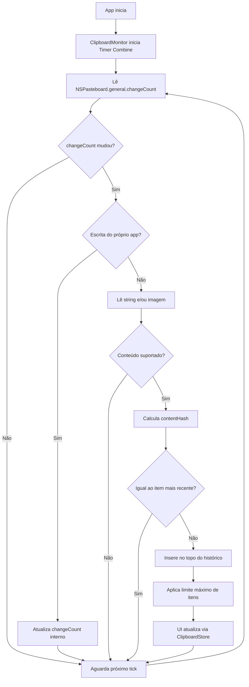
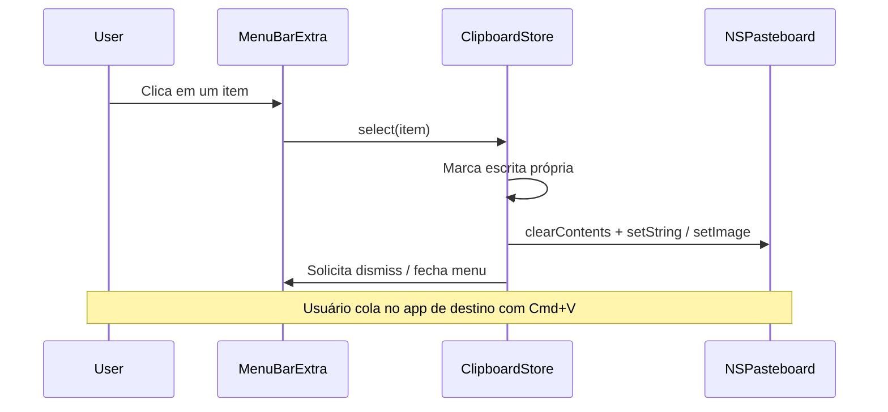

# PRD — copyMemory

| Campo | Valor |
| --- | --- |
| Produto | copyMemory |
| Plataforma | macOS (nativo, SwiftUI) |
| Bundle ID | `com.vinicius.copyMemory` |
| Versão do documento | 1.0 |
| Status | Draft — MVP |
| Superfície de UI | Menu Bar (`MenuBarExtra`) apenas |

---

## 1. Visão Geral

### 1.1 Problema

Usuários de macOS frequentemente copiam vários trechos de texto e imagens em sequência (links, códigos, prints, mensagens) e perdem o conteúdo anterior porque a área de transferência nativa guarda apenas o item mais recente. Soluções existentes costumam ser pesadas, invasivas (ícone no Dock, janelas permanentes) ou com recursos além do necessário para o dia a dia.

### 1.2 Proposta de valor

**copyMemory** é um gerenciador de área de transferência **leve e discreto** que:

- vive exclusivamente na **barra de menus**;
- monitora cópias de **texto e imagens** em tempo real;
- mantém um histórico **da sessão atual** para busca e reutilização rápida;
- ao selecionar um item, **copia de volta** e **fecha o menu**.

### 1.3 Público-alvo

- Desenvolvedores, designers e knowledge workers em macOS.
- Quem copia/cola com alta frequência e quer recuperação imediata sem abrir apps pesados.

### 1.4 Princípios de produto

1. **Leve** — baixo uso de CPU e memória; sem persistência em disco no MVP.
2. **Discreto** — sem ícone no Dock; presença mínima na menu bar.
3. **Rápido** — abrir, buscar, clicar, colar; latência percebida mínima.
4. **Privado** — dados só em RAM; sem rede, telemetria ou sync.
5. **Focado** — texto + imagens; sem feature creep no MVP.

### 1.5 Escopo do MVP

**Incluído**

- App agent / menu bar only (`MenuBarExtra`).
- Monitoramento da pasteboard geral (`NSPasteboard.general`).
- Captura de **texto** e **imagens**.
- Histórico em memória, ordenado do mais recente ao mais antigo.
- Limite máximo de itens (ver RNF).
- Deduplicação de cópias consecutivas iguais.
- Busca/filtro por texto no histórico.
- Clique no item → re-copiar + fechar menu.
- Proteção contra loop de re-cópia gerada pelo próprio app.
- Empty state e previews (texto truncado / thumbnail de imagem).

**Fora do escopo (MVP)**

- Persistência entre reinícios (UserDefaults, SwiftData, arquivos).
- Arquivos (paths), RTF/HTML ricos, áudio, conteúdo de apps especializados.
- Sync iCloud / multi-dispositivo.
- Atalhos globais de teclado (pode entrar no roadmap).
- Pin / favoritos persistentes.
- Colagem automática no app em foco (Accessibility) — o MVP só recoloca na pasteboard.
- Conta, cloud, analytics.

### 1.6 Roadmap (não-MVP)

| Fase | Itens |
| --- | --- |
| Pós-MVP | Remover item individual; limpar histórico; atalho global para abrir o menu |
| Futuro | Persistência opcional; arquivos; pin; configurações (limite, intervalo de poll) |

---

## 2. Arquitetura Técnica

### 2.1 Stack

| Camada | Tecnologia |
| --- | --- |
| UI | SwiftUI — `MenuBarExtra` |
| Estado | `@Observable` (preferencial em macOS moderno) ou `ObservableObject` + `@StateObject` |
| Monitoramento | AppKit — `NSPasteboard` |
| Reatividade / polling | Combine — `Timer.publish` (ou equivalente) observando `changeCount` |
| Persistência MVP | Nenhuma (somente RAM) |
| App shell | `LSUIElement` / app sem janela principal e sem Dock |

### 2.2 Camadas e responsabilidades

```
copyMemoryApp (Scene: MenuBarExtra)
        │
        ▼
┌───────────────────┐
│  ClipboardViews   │  Lista, busca, empty state, células texto/imagem
└─────────┬─────────┘
          │ observa
          ▼
┌───────────────────┐
│ ClipboardStore    │  Histórico, busca, select/copy, limites, dedupe
│ (@Observable)     │
└─────────┬─────────┘
          │ consome eventos
          ▼
┌───────────────────┐
│ ClipboardMonitor  │  Poll changeCount → lê string/image → emite item
│ (Combine)         │
└─────────┬─────────┘
          │
          ▼
     NSPasteboard.general
```
| Componente | Responsabilidade |
| --- | --- |
| `copyMemoryApp` | Entry point; declara `MenuBarExtra`; injeta store; sem `WindowGroup` principal no MVP |
| Views | Apresentação, campo de busca, lista, ações de clique |
| `ClipboardStore` | Fonte da verdade do histórico; filtro; escrita de volta na pasteboard; dismiss do menu |
| `ClipboardMonitor` | Detecta mudanças via `changeCount`; lê tipos suportados; evita reentrância |
| `ClipboardItem` | Modelo imutável (ou value type) do item capturado |

### 2.3 Modelo de dados

```swift
enum ClipboardContentType {
    case text
    case image
}

struct ClipboardItem: Identifiable, Equatable {
    let id: UUID
    let type: ClipboardContentType
    let text: String?          // payload texto e/ou texto para busca
    let imageData: Data?       // payload imagem (ou representação compacta)
    let thumbnail: Data?       // preview leve para a lista
    let createdAt: Date
    let contentHash: String    // dedupe (hash do conteúdo relevante)
}
```

Regras:

- Itens de texto: `text` preenchido; `imageData`/`thumbnail` nulos.
- Itens de imagem: `imageData` (e/ou `NSImage` em memória) + `thumbnail` obrigatório para UI; `text` pode ser `nil` ou metadado opcional.
- `contentHash` usado para deduplicação (especialmente consecutivos).

### 2.4 Fluxo de monitoramento



### 2.5 Fluxo de reutilização (clique)



### 2.6 Combine e ciclo de vida

- `ClipboardMonitor` publica mudanças via `PassthroughSubject<ClipboardItem, Never>` (ou callback para o store).
- Polling sugerido: **0,5 s** (`Timer.publish(every: 0.5, on: .main, in: .common)`), ajustável depois.
- Cancelamento: `AnyCancellable` no `deinit` / quando o app termina.
- Toda mutação de UI/histórico no **MainActor**.

### 2.7 Configuração do app macOS

| Item | Diretriz |
| --- | --- |
| Dock | Oculto (`LSUIElement` / Application is agent) |
| Janela | Sem `WindowGroup` principal no MVP |
| Sandbox | Mantido; validar leitura da pasteboard geral no runtime |
| Rede | Não requerida |
| Hardened Runtime | Mantido conforme projeto atual |

### 2.8 Estrutura de pastas sugerida

```
copyMemory/
  copyMemoryApp.swift
  Models/
    ClipboardItem.swift
  Services/
    ClipboardMonitor.swift
  Store/
    ClipboardStore.swift
  Views/
    ClipboardMenuView.swift
    ClipboardItemRow.swift
    EmptyClipboardView.swift
```

---

## 3. Requisitos Funcionais

| ID | Requisito | Prioridade | Notas |
| --- | --- | --- | --- |
| **RF01** | O app deve monitorar a área de transferência geral em tempo quase real, detectando mudanças via `NSPasteboard.general.changeCount`. | Must | Polling Combine ~0,5 s |
| **RF02** | O app deve capturar conteúdo de **texto** (`String` / tipos string da pasteboard) e **imagens** (`NSImage` / TIFF/PNG representáveis). | Must | Outros tipos são ignorados |
| **RF03** | O app deve manter um histórico em memória, ordenado do mais recente para o mais antigo, com limite máximo configurável em código (padrão **50** itens). | Must | Ao exceder, remove os mais antigos |
| **RF04** | Cópias consecutivas com o mesmo `contentHash` não devem gerar novo item no topo. | Must | Dedupe consecutivo |
| **RF05** | O usuário deve poder filtrar o histórico por texto (case-insensitive, substring). Itens só-imagem aparecem na busca apenas se houver texto associado; caso contrário, ficam visíveis quando a busca está vazia. | Must | Campo no topo do menu |
| **RF06** | Ao clicar em um item, o app deve copiar o conteúdo de volta para a pasteboard e fechar o menu imediatamente. | Must | Ação primária |
| **RF07** | Escrita originada pelo próprio app não deve reinserir o mesmo item no histórico (evitar loop). | Must | Flag / changeCount “próprio” |
| **RF08** | Com histórico vazio (ou filtro sem resultados), o menu deve exibir empty state claro. | Must | Mensagens distintas: vazio vs. sem resultados |
| **RF09** | A UI deve distinguir visualmente itens de texto (preview truncado) e de imagem (thumbnail). | Must | — |
| **RF10** | O histórico existe apenas durante a sessão do processo; ao encerrar o app, os dados são descartados. | Must | Sem I/O de persistência |
| **RF11** | Nice-to-have: ação para limpar todo o histórico e/ou remover um item. | Should | Não bloqueia MVP se adiado |

### 3.1 Critérios de aceite (MVP)

1. Copiar texto em outro app → item aparece no topo do menu em ≤ 1 s.
2. Copiar imagem → thumbnail aparece na lista.
3. Digitar na busca reduz a lista aos textos correspondentes.
4. Clicar item de texto → pasteboard contém esse texto; menu fecha.
5. Clicar item de imagem → pasteboard contém a imagem; menu fecha.
6. Recopiar o mesmo texto duas vezes seguidas → um único item no topo.
7. Encerrar e reabrir o app → histórico vazio.

---

## 4. Requisitos Não-Funcionais

| ID | Categoria | Requisito |
| --- | --- | --- |
| **RNF01** | Desempenho | Polling ≤ 2 Hz (padrão 0,5 s) sem trabalho pesado quando `changeCount` não muda. |
| **RNF02** | Desempenho | Seleção de item (copiar + fechar menu) com latência percebida **&lt; 100 ms** em hardware recente. |
| **RNF03** | Memória | Limite padrão de **50** itens. Imagens armazenadas com thumbnail para lista; payload completo só o necessário para re-copiar. |
| **RNF04** | Memória | Ao atingir o limite, descartar itens mais antigos (FIFO pelo fundo da lista). Considerar downscale de imagens muito grandes na captura (ex.: lado máximo do thumbnail 128–256 px). |
| **RNF05** | CPU | Em idle (sem mudanças de pasteboard), impacto de CPU desprezível (apenas timer leve). |
| **RNF06** | Privacidade | Nenhum dado de clipboard escrito em disco, enviado pela rede ou logado em texto completo. |
| **RNF07** | Confiabilidade | App não deve crashar ao encontrar tipos de pasteboard não suportados ou conteúdo vazio. |
| **RNF08** | UX / presença | Sem ícone no Dock; apenas ícone na menu bar. |
| **RNF09** | Manutenibilidade | Código modular (Monitor / Store / Views); alinhado a SwiftUI moderno e às regras do projeto (`.cursorrules`). |
| **RNF10** | Persistência | Explicitamente **proibido** no MVP persistir histórico. |

### 4.1 Orçamentos sugeridos

| Recurso | Orçamento |
| --- | --- |
| Itens no histórico | 50 |
| Intervalo de poll | 500 ms |
| Truncamento de preview de texto na lista | ~80–120 caracteres |
| Thumbnail | ≤ 256 px no maior lado |
| Rede | 0 |

---

## 5. Desafios Técnicos

### 5.1 Sandbox e pasteboard

O projeto atual habilita App Sandbox. Leitura/escrita da pasteboard geral costuma funcionar para apps locais, mas deve ser **validada cedo** no runtime. Se alguma restrição aparecer, documentar entitlement ou ajuste mínimo necessário sem abrir o escopo de segurança.

### 5.2 Imagens e pressão de memória

Screenshots e PNGs grandes podem estourar RAM se mantidos em resolução total × 50 itens. Mitigações:

- gerar thumbnail na captura;
- opcionalmente redimensionar/comprimir o payload reutilizável;
- aplicar o limite de 50 com rigor;
- evitar cópias desnecessárias de `Data`/`NSImage` na UI.

### 5.3 Loop de re-cópia

Ao colocar um item de volta na pasteboard, o `changeCount` muda e o monitor tenderia a reinserir o item. Solução obrigatória:

- marcar “escrita própria” antes do write;
- após o write, sincronizar o `changeCount` observado;
- ignorar a próxima mudança correspondente (ou enquanto a flag estiver ativa).

### 5.4 Fechar o `MenuBarExtra` programaticamente

SwiftUI não oferece uma API única e estável em todas as versões para dismiss do menu extra. O MVP precisa de uma estratégia concreta (ex.: binding de `isPresented` quando disponível, ou bridge AppKit mínimo). Aceite: após o clique, o menu **não permanece aberto**.

### 5.5 Preview de imagens no menu

Menus da barra são estreitos. Thumbnails devem ser pequenos, com aspect-fit, sem layout quebrado para imagens panorâmicas ou muito altas.

### 5.6 Conteúdo misto na pasteboard

Uma única operação de cópia pode expor texto **e** imagem. Regra MVP:

- preferir **imagem** se houver representação de imagem utilizável;
- caso contrário, capturar **texto**;
- não criar dois itens da mesma mudança.

### 5.7 Deployment target e APIs modernas

O template do projeto aponta para um deployment target macOS recente. O PRD assume APIs SwiftUI modernas (`MenuBarExtra`, `@Observable` quando disponível). Implementação deve seguir o target do Xcode do repositório e as diretrizes de `.cursorrules`.

### 5.8 Substituição do template atual

Hoje o app usa `WindowGroup` + `ContentView` (“Hello, world!”). A implementação do MVP deve **substituir** essa superfície por `MenuBarExtra` e remover a janela principal do fluxo padrão.

---

## 6. Considerações de UX

### 6.1 Presença

- Ícone SF Symbol discreto na menu bar (ex.: `doc.on.clipboard` ou similar).
- Sem badges numéricos ruidosos no MVP.
- Sem janelas flutuantes.

### 6.2 Hierarquia do menu (uma composição)

De cima para baixo:

1. Campo de **busca**.
2. Lista de itens (mais recente primeiro).
3. Empty state quando aplicável.

Evitar cards, stats, promoções ou configurações no primeiro desenho do MVP.

### 6.3 Célula de item

| Tipo | Apresentação |
| --- | --- |
| Texto | Uma linha (ou duas no máximo) truncada com reticências; tipografia legível e densa |
| Imagem | Thumbnail à esquerda + label curta (“Imagem” ou dimensões) |

Hover/highlight nativo do menu; clique = ação completa (copiar + fechar).

### 6.4 Busca

- Placeholder claro (ex.: “Buscar…”).
- Filtro imediato (a cada keystroke).
- Sem resultados: mensagem “Nenhum item encontrado”.
- Histórico vazio: “Nenhuma cópia ainda” (ou equivalente).

### 6.5 Teclado

Quando o menu estiver aberto e o sistema permitir:

- navegação por setas na lista;
- Return para selecionar o item focado (mesmo comportamento do clique).

Se o `MenuBarExtra` limitar o foco de teclado, documentar a limitação; mouse continua sendo o caminho garantido do MVP.

### 6.6 Feedback

- Sem toasts pesados.
- Feedback principal = menu fecha + conteúdo disponível para Cmd+V.
- Opcional futuro: breve highlight no ícone da menu bar.

### 6.7 Tom visual

- Utilitário macOS nativo: limpo, denso, sem decoração excessiva.
- Respeitar light/dark mode do sistema.
- Priorizar legibilidade do texto copiado sobre ornamentação.

### 6.8 Privacidade na UI

- Não exibir alertas alarmistas.
- Assumir que o usuário entende que o histórico é da sessão e some ao sair (pode ser mencionado em empty state ou futuro painel “Sobre”).

---

## 7. Métricas de sucesso (qualitativas — MVP)

- Tempo para reutilizar um item copiado recentemente &lt; 2 interações (abrir menu → clicar).
- App permanece “invisível” no uso diário (sem Dock, sem popups).
- Sem reclamações de consumo perceptível de RAM/CPU em sessão típica de trabalho.

---

## 8. Dependências e riscos

| Risco | Impacto | Mitigação |
| --- | --- | --- |
| Dismiss do MenuBarExtra difícil na API SwiftUI | UX quebrada (menu fica aberto) | Spike técnico cedo; fallback AppKit |
| Imagens grandes | Alto uso de memória | Thumbnail + limite + downscale |
| Loop de re-cópia | Histórico poluído / bugs | Flag de escrita própria |
| Expectativa de persistência | Surpresa ao reiniciar | Comunicação no PRD/UX; fase futura |

---

## 9. Referências internas

- Diretrizes do projeto: [`.cursorrules`](../.cursorrules)
- Entry point atual (a ser evoluído): [`copyMemory/copyMemoryApp.swift`](../copyMemory/copyMemoryApp.swift)
- Checklist de implementação (futuro): `docs/TASKS.md`
)
